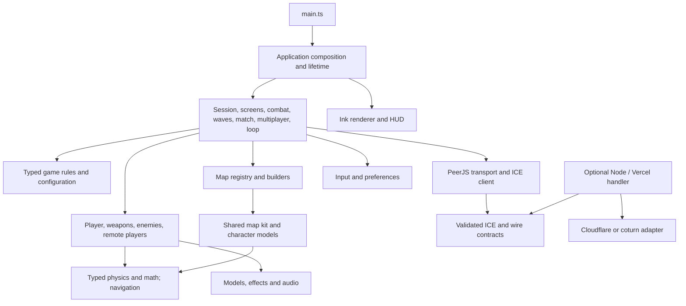

# Architecture

Paper Shooter is a modular browser game with an optional HTTP credential service. Its entry point
composes concrete adapters and controllers; a dependency container or framework is not required.

## Responsibilities

| Directory          | Owns                                                                             | Does not import                       |
| ------------------ | -------------------------------------------------------------------------------- | ------------------------------------- |
| `src/domain`       | Map metadata, wave plans, scores, match/idle rules, enemy and weapon data        | Application, DOM, HTTP, rendering     |
| `src/shared`       | ICE validation, palette identifiers                                              | Application and platform services     |
| `src/engine`       | Collision world, bodies, numeric helpers, springs, navigation, resource disposal | UI, networking, gameplay controllers  |
| `src/maps`         | Existing map content and a reusable construction kit                             | Application state and enemy AI        |
| `src/gameplay`     | Stateful player, weapons, enemy behavior, projectiles and remote models          | Screens and application orchestration |
| `src/presentation` | Ink renderer, reusable models, HUD, effects and audio synthesis                  | Application and network transports    |
| `src/platform`     | Browser input and persistent preferences                                         | Application and network transports    |
| `src/network`      | PeerJS lifecycle, lobby transport, ICE caching and wire envelopes                | Gameplay, DOM screens and rendering   |
| `src/application`  | Composition, shared session state, controller actions and scheduling             | —                                     |
| `server`           | HTTP handling, runtime configuration, rate limiting and provider adapters        | Browser application and rendering     |

`pnpm architecture` checks allowed imports, missing relative modules and import cycles across
browser, server and API modules, including literal dynamic imports and re-exports. It is part of
hooks and CI. It does not detect semantic cycles through runtime callbacks or shared mutable state.
Runtime callbacks between controllers are supplied explicitly by composition;
controllers do not import each other. `ApplicationOptions` defines replaceable rendering, input,
storage, audio and network adapters for embedding and integration tests.

## State and lifetime

`createRuntime` owns one world, level, navigation grid, renderer, audio instance, input adapter,
local player, enemy manager, connection transport, remote players and session state. Switching maps
updates the level/navigation references in the gameplay context. Map geometry is not edited by the
application controllers. `createApplication` wires actions before starting its animation/background
schedulers. Its idempotent `dispose()` stops schedulers, releases listeners/connections/audio and
disposes scene/rendering resources. Permanent page navigation and Vite teardown call it.

`SceneResources` belongs to the application. Register constructed nodes with `track`; `release`
retires their current subtree. Reparenting an existing tracked fragment transfers ownership without
counting it twice. Shared geometry/materials survive until their last tracked mesh or explicit cache
lease releases them. Renderer render targets and audio contexts retain their separate adapter
lifetimes. See [ADR 0008](adr/0008-scene-resource-ownership.md).

The loop keeps the original variable timestep, capped at 50 ms, hitstop and focus scaling. Input,
simulation, death/respawn, idle/lobby updates and presentation have separate phases. Moving to a
fixed timestep, rollback netcode or a different physics engine would change behavior and needs a
separate decision and regression baseline.

## Paradigms and patterns

- Pure typed functions describe wave plans, scores, clocks, map lookup and input validation. Random
  draws and clocks can be supplied by tests.
- Stateful classes represent resources with identity: collision worlds, player bodies, connections,
  renderers and audio contexts. Reusable vectors and pools remain in frame-sensitive code.
- Small controller factories coordinate effects and state through explicit actions. Provider and
  browser adapters isolate external APIs. There is no global audio singleton.
- Ink materials are reusable without importing renderer lifecycle. Each renderer owns its palette
  and frame uniforms; material draw hooks bind that renderer's frame without sharing mutable
  lighting/time between application instances. Frame calculations run once per render, with no
  per-material lighting transform or per-frame object allocation introduced by the binding.
- Composition replaces an inheritance hierarchy for application services. The existing weapon/view
  model hierarchy remains where it already models shared behavior; an ECS is not introduced.

TypeScript strict mode covers domain rules, shared contracts, physics/math, registry, network
configuration and backend. Existing procedural graphics, gameplay and controllers remain JavaScript
under `allowJs` with `checkJs: false`; those modules are **not** fully statically checked. Tests and
coverage include them. This is an explicit incremental typing decision, not a completed conversion
of every source file. See [ADR 0003](adr/0003-modular-architecture.md).

## Remaining decomposition

The player and enemy modules still contain large stateful implementations. Player update phases
are named, but movement abilities, equipment and damage state still share one class. Enemy geometry,
data and projectiles are separate, while archetype behavior, animation and damage processing remain
in the manager module. These are candidates for extraction behind the existing gameplay contracts
and regression tests. File length is a review signal; splitting by an arbitrary line limit does not
replace cohesive responsibilities or explicit state ownership. A passed coverage/quality gate is
not proof that this remaining architecture work is finished. The
[manual review](reviews/2026-11-14-refactor.md) inventories additional coupling below and above the
[engineering standard's](engineering-standard.md) size thresholds.

## Adding a map

1. Add its key/name/blurb to `src/domain/maps.ts`. Lookup and menu metadata follow the registry.
2. Implement a builder in `src/maps` using `MapKit`, then register it in `src/maps/index.ts`.
   The typed registry requires a builder for every map key.
3. Return the level contract: bounds, player start, enemy/sniper/pickup positions, arena spawns,
   breakables, animated objects and owned meshes. Call the kit's `finish()` to merge geometry and
   finalize colliders. Supply at least one valid start/spawn/pickup point.
4. Test solo and arena variants, collision clearance and multiplayer agreement. Add a recorded
   seeded output fixture only after reviewing the intended map change.

The kit exposes boxes, walls with gaps, stairs, rails, cylinders, spheres, grapple rings, spawn
markers and moving paper planes. Reusable character/weapon geometry lives in
`src/presentation/models/characters.js`, independently of enemy AI. District and Mexico retain their
existing geometry, colliders and spawn positions. Dynamic map generation is a future consumer of
this contract; it is not implemented by this refactor.
